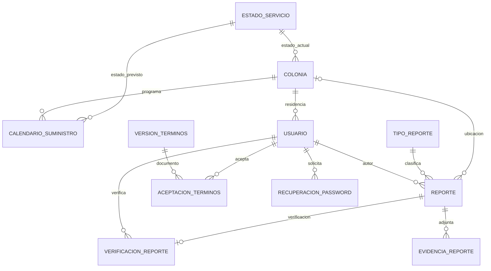

# Normalización de la base de datos de AguApp

Actividad: «Realizar la normalización de DB para realizar pruebas con los controllers de Springboot».

## Resultado y alcance

Se diseñó un modelo relacional en tercera forma normal (3FN), se crearon migraciones SQL y se reemplazaron las listas fijas de los dos controllers por consultas JDBC. Se mantienen las rutas GET y el JSON original. PostgreSQL 16 es el motor de referencia; el profesor no especificó uno. No se necesita JPA para consultar una base normalizada.

El backend contiene solo `ColoniaController` y `ReporteController`. El esquema cubre también los datos observados en Angular: registro, términos, recuperación, calendario, GPS y fotos. Esas funciones todavía no tienen endpoints de backend. El frontend sigue usando servicios simulados; conectarlo a HTTP y crear los endpoints de escritura es trabajo posterior.

## Inventario del proyecto y hallazgos

| Fuente revisada | Datos y observaciones | Destino |
|---|---|---|
| `models/user.model.ts`, `auth.model.ts`, `AuthService` | ID, nombre, correo, contraseña, colonia, confirmación y términos. Usuarios en memoria; sesión en localStorage; contraseña en texto plano; token simulado | usuario, versión y aceptación de términos; almacenar hash de contraseña generado por el backend |
| `LoginComponent` | Registro y login simulados; recuperación solo muestra un mensaje. Al pasar de registro a recuperación quedan validadores de registro activos | recuperacion_password; corrección de validación pendiente |
| `colonia.model.ts` y `ColoniaController` | Cuatro colonias, ID estable, nombre, estado del servicio | colonia y estado_servicio |
| `Report`, `DatosNuevoReporte`, `ReportModalComponent` | Tipo, notas opcionales, colonia opcional, GPS opcional, foto, fecha y verificación | reporte, tipo_reporte, evidencia_reporte, verificacion_reporte |
| `DashboardMainComponent` | El modal emite `type/notes/photo`, pero el consumidor espera `tipo/notas`; no aporta colonia ni autor | Contrato a corregir antes de integrar Angular; obtener autor de sesión autenticada |
| `ServicioReportes` | Noticias y pines independientes, en memoria, con IDs diferentes. Las fotos no llegan al servicio; una fuga se representa como corte | Proyecciones de reporte; tipo y estado del servicio son conceptos diferentes |
| `ComponenteMapa` | Coordenadas, colonia y color; centro del mapa CDMX; no permite editar ubicación | Coordenadas de colonia para resumen y de reporte para el incidente |
| `ComponenteBarraLateral` | Calendario con nombres, fechas en texto sin año y estado; noticias | calendario_suministro con DATE; feed derivado de reportes |
| `main.component.html` | «Sin avisos críticos» y «Actualizado» no se calculan de una fuente real | Indicadores futuros derivados de datos; no crear tablas para textos estáticos |
| Backend `model/*.java` | records de respuesta, fechas como String y coordenadas primitivas | Se conservan DTO; coordenadas pasan a Double para admitir NULL |
| Controllers, tests y Postman | Dos controllers GET, listas fijas, filtro por tipo y 404 por ID | JDBC y pruebas de integración con migraciones |
| `pom.xml`, properties y wrappers | Spring Boot 3.3.5 / Java 17, sin persistencia originalmente | JDBC, PostgreSQL, Flyway y H2 solo para tests |
| `all-code.txt` | Copia antigua: contiene login que acepta cualquier correo y un servicio inglés ya inexistente | No usar como código vigente |
| Módulo, guard, arranque, estilos y recursos | Navegación y presentación; no añaden entidades. Sin HttpClient. Configuración referencia favicon inexistente y estilos de tests en ruta distinta | No modificados; no intervienen en normalización |

Se inspeccionaron los archivos propios del proyecto, incluyendo el backend, la configuración, pruebas y colección Postman. `node_modules`, `dist` y `.angular` son dependencias o salidas generadas, no el modelo de negocio.

## Supuestos de negocio explícitos

- El alcance actual es una sola localidad: el nombre de colonia es único. Si hay municipios, se añadirá municipio y la unicidad será `(municipio_id, nombre)`; no inventar municipio a partir de la coordenada del mapa.
- Un usuario tiene una colonia de residencia; un reporte puede pertenecer a otra colonia. La colonia del incidente se conserva aunque el usuario se mude. No es un dato derivable de la residencia.
- Reportes requieren autor; pueden carecer de colonia y GPS, pues el modal permite enviar con GPS denegado y no pide colonia. Sin coordenadas no se genera un pin. Si se decide exigir ubicación, cambiar validaciones de frontend, backend y DB conjuntamente.
- Una colonia tiene un estado actual de servicio; el calendario representa el estado previsto para cada fecha. No se implementa historial de cambios del estado actual.
- Un día tiene una entrada de suministro por colonia. Si se necesitan varios turnos, habrá que añadir intervalos y revisar esa clave candidata.
- Un reporte tiene cero o una verificación actual y cero o muchas fotos. Revocar la verificación elimina esa relación; un historial de revisión necesitaría una tabla adicional de eventos.
- El usuario verificador existe en DB; quién puede verificar, límites de archivos y expiración de tokens se validarán en servicios autenticados. Las cuentas demo están bloqueadas y no implementan login.
- Las fechas sin año del calendario se interpretaron como septiembre de 2026 únicamente en el seed de demostración; no representan un suministro real confirmado.

## De una estructura plana a 3FN

Una estructura plana mezclaría `reporteId, autorId, autorNombre, email, coloniaId, coloniaNombre, tipoCodigo, tipoNombre, estadoCodigo, estadoNombre, fotos[], verificado, verificadorNombre, fechaCalendarioTexto`. Causaría anomalías: renombrar una colonia exigiría modificar muchos reportes; borrar el último reporte perdería sus catálogos; no se podría registrar una colonia sin incidente.

**1FN:** cada columna contiene un valor del dominio, cada fila tiene clave primaria y las fotos se separan en filas de evidencia. GPS se divide en latitud/longitud. El calendario usa DATE, no «Lun 21 Sep». Confirmación de contraseña es validación de entrada y no se persiste.

**2FN:** los atributos dependen de la clave completa. En `aceptacion_terminos`, la fecha depende del par `(usuario_id, version_terminos_id)`; datos del usuario o del documento se guardan en sus respectivas tablas. Las demás tablas tienen clave primaria simple.

**3FN:** no se almacenan dependencias transitivas como `reporteId → coloniaId → coloniaNombre` o `reporteId → tipoCodigo → tipoNombre`. Se guardan IDs/códigos y se recuperan etiquetas mediante JOIN. `verificado` se obtiene con EXISTS, evitando dos fuentes de verdad. Un título del feed generado de tipo/notas tampoco se almacena.

## Diccionario, claves y dependencias funcionales

Todos los IDs usan VARCHAR(64) para conservar `c_centro` y `r1`. Nuevos IDs deberán ser UUID generados en backend. Los códigos son VARCHAR(20). Ninguna FK guarda listas separadas por comas.

| Tabla | Clave primaria | Atributos y dependencias | Relaciones / claves candidatas |
|---|---|---|---|
| estado_servicio | codigo | codigo → nombre | nombre UNIQUE; normal, baja, corte |
| tipo_reporte | codigo | codigo → nombre | nombre UNIQUE; fuga, baja, corte |
| colonia | id | id → nombre, estado_servicio_codigo, latitud, longitud | nombre UNIQUE; FK estado; GPS opcional |
| usuario | id | id → nombre, email, password_hash, colonia_id, creado_en | email UNIQUE, minúsculas sin espacios externos; FK colonia |
| version_terminos | id | id → version, documento_url, publicado_en | version UNIQUE |
| aceptacion_terminos | usuario_id + version_terminos_id | clave completa → aceptado_en | FKs usuario y versión; materializa N:M |
| reporte | id | id → tipo_codigo, usuario_id, colonia_id, notas, latitud, longitud, creado_en | FKs tipo, autor, colonia opcional; notas opcionales |
| verificacion_reporte | reporte_id | reporte_id → verificador_id, verificado_en | FK reporte y usuario; 0..1 por reporte |
| evidencia_reporte | id | id → reporte_id, archivo_url, nombre_original, mime_type, bytes, creado_en | FK reporte; metadata de foto, archivo fuera de DB |
| calendario_suministro | id | id → colonia_id, fecha, estado_servicio_codigo | `(colonia_id, fecha)` UNIQUE; FKs colonia y estado |
| recuperacion_password | id | id → usuario_id, token_hash, creado_en, expira_en, utilizado_en | token_hash UNIQUE, hash SHA-256 de 64 caracteres; FK usuario |

El DDL es el diccionario físico exacto: longitudes, NULL/NOT NULL, tipos, FK y CHECK se encuentran en `V1__esquema_normalizado.sql`. Las restricciones impiden pares GPS incompletos, coordenadas fuera de rango, fotos de cero bytes y expiraciones anteriores a la creación. La forma y seguridad del email, hash y URL requieren validación adicional de aplicación; un CHECK de longitud no sustituye a un hash criptográfico.

Contraseñas: generar hash con un PasswordEncoder seguro en backend y nunca devolverlo en DTO. Recuperación: guardar solo el hash del token aleatorio; su consumo debe hacerse en una transacción con condición de no usado/no expirado. Sesiones JWT no requieren tabla por sí solas. No almacenar `confirm`, vista previa base64, temporizadores del login, colores CSS ni títulos derivados.

## Diagrama entidad-relación

Las FK restringen eliminaciones de colonias, usuarios y catálogos usados. Evidencias y verificación se eliminan en cascada con su reporte; recuperaciones con su usuario. El borrado del archivo externo requiere servicio propio. La DB no concede permisos de moderación.

## Lectura de los controllers

`ColoniaController → ColoniaRepository → JdbcTemplate → colonia` devuelve id, nombre y código de estado. `ReporteController → ReporteRepository` une reporte/colonia y calcula verificado con EXISTS. Las consultas parametrizadas preservan la búsqueda sin distinguir mayúsculas y el filtro original. El tipo desconocido devuelve `[]`, tal como antes. Orden estable: colonias por ID; reportes por fecha descendente y luego ID.

Se conserva `fecha` como `yyyy-MM-dd` en JSON por compatibilidad; la DB guarda timestamp con zona y el repositorio obtiene la fecha de America/Mexico_City. Las coordenadas ausentes llegan como JSON null. En un nuevo contrato se recomienda devolver también `coloniaId`, `usuarioId` y timestamp completo; no se añade ahora para alterar lo mínimo necesario.

Los marcadores de colonia pueden consultarse con sus coordenadas y estado actual. Los marcadores de incidentes pueden consultarse desde reporte cuando tiene GPS, con la regla visual fuga → corte en la capa de presentación. No se debe cambiar automáticamente el estado oficial de colonia ante un reporte ciudadano pendiente.

## Referencias técnicas

- [Restricciones de PostgreSQL](https://www.postgresql.org/docs/16/ddl-constraints.html): integridad mediante PK, UNIQUE, CHECK y FK.
- [Inicialización de datos en Spring Boot](https://docs.spring.io/spring-boot/how-to/data-initialization.html): usar Flyway como mecanismo único de migración. Este proyecto usa JDBC; no tiene entidades JPA ni necesita ddl-auto.
