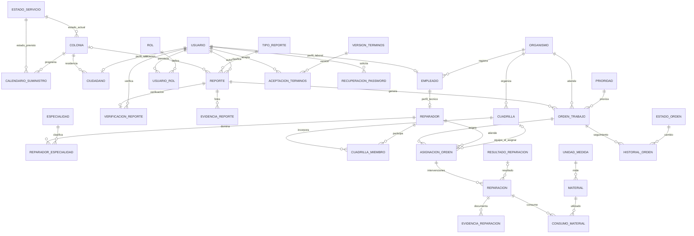

# Normalización de la base de datos de AguApp

> **Antecedente, no modelo final:** este documento describe el esquema de 32 tablas implementado anteriormente. La nueva [especificación de ODAPAS Report](ODAPAS_REPORT_ESPECIFICACION.md) define alta laboral exclusivamente administrativa, zonas, direcciones completas y alertas. Sustituye las alternativas de registro personal propuestas aquí y será la base del próximo modelo relacional.

Actividad del profesor: «Realizar la normalización de DB para realizar pruebas con los controllers de Springboot».

## Resultado y alcance

Modelo relacional en tercera forma normal (3FN), **32 tablas y 43 relaciones**, migraciones SQL y cuatro controllers GET conectados mediante JDBC. Incluye ciudadanos y reparadores con registro separado, supervisores, organismos, cuadrillas y seguimiento de trabajos. PostgreSQL 16 es el motor de referencia; el profesor no indicó uno. Se conservan las URLs y respuestas de los controllers originales. No se necesita JPA para normalizar o consultar una DB.

El esquema contempla los datos de negocio identificados en Angular/Spring Boot y la ampliación solicitada para personal de reparación. Existen controllers de consulta para colonias, reportes, reparadores y órdenes. Registro, aprobación de personal, asignación, escritura de reparaciones, términos, recuperación, fotos y calendario aún requieren servicios/controllers de escritura y autenticación. Angular sigue simulado. El esquema representa un organismo de atención de agua; no es una copia de la base interna real de ODAPAS.

## Revisión del proyecto

| Archivos o componente | Hallazgo | Decisión de persistencia |
|---|---|---|
| user.model.ts, auth.model.ts, AuthService | Nombre, email, contraseña, colonia. Usuarios en memoria, contraseña en texto plano, token de demo, sesión en localStorage | usuario; password_hash generado en backend; sesión no es un usuario duplicado |
| LoginComponent | Confirmación de contraseña y aceptación de términos; recuperación solo muestra mensaje. Quedan validadores de registro al pasar a recuperación | No guardar confirm; version_terminos, aceptacion_terminos y recuperacion_password |
| colonia.model.ts, ColoniaController | 4 colonias con ID estable, nombre y estado actual | colonia y estado_servicio |
| report.model.ts, reporte.model.ts, ReportModalComponent | Tipo, notas, GPS opcional, colonia opcional, foto, fecha, verificación | reporte, tipo_reporte, evidencia_reporte y verificacion_reporte |
| DashboardMainComponent | Modal devuelve type/notes/photo; servicio espera tipo/notas. No transmite colonia ni autor | Error de contrato pendiente; autor debe provenir de sesión autenticada |
| ServicioReportes | Reportes/pines/noticias en memoria con IDs independientes; foto ignorada; fuga dibujada como corte | Feed derivado de reportes; pines como proyecciones, sin duplicar incidente |
| ComponenteMapa | Coordenadas de colonias demo, estado y colores; centro CDMX | GPS de colonia para resumen; GPS de reporte para incidente |
| ComponenteBarraLateral | Calendario fijo con colonia por nombre, fecha sin año y estado | calendario_suministro: FK colonia, DATE y FK estado |
| main.component.html | «Sin avisos críticos» y «Actualizado» no se calculan de datos | Indicadores a calcular en integración; no tablas para textos fijos |
| Backend controllers/model | Dos controllers GET con listas fijas, filtro y 404. DTO con coordenadas primitivas | Repositorios JDBC; Double nullable para GPS ausente |
| Backend tests/Postman | Pruebas de colonias, filtro y ausencia; IDs c_centro/r1/r2/r3 | Mantener IDs demo; añadir pruebas de persistencia e integridad |
| pom.xml/properties/wrappers | Spring Boot 3.3.5, Java 17, inicialmente sin DB | JDBC, Flyway, PostgreSQL; H2 solo en tests |
| all-code.txt | Copia antigua con login que acepta cualquier correo y servicio inglés ya inexistente | No tomar la copia como implementación vigente |
| Módulo, guard, arranque, estilos, assets y configuración Angular | Presentación y navegación; sin HttpClient. favicon referenciado no existe y ruta de estilos de tests no coincide | No aportan entidades; problemas de configuración pendientes |

Se inspeccionaron los archivos propios de ambos proyectos, configuración, pruebas y colección Postman. Dependencias (`node_modules`) y salidas (`dist`, `.angular`, `target`) no constituyen requisitos de negocio.

## Supuestos explícitos

- Una sola localidad: nombre de colonia único. Si se incorporan municipios, añadir entidad municipio y cambiar unicidad a `(municipio_id, nombre)`. No inferir municipio solo del centro del mapa.
- La cuenta común guarda credenciales; el perfil ciudadano guarda colonia de residencia. El perfil empleado guarda organismo y número de empleado. Un usuario puede tener ambos perfiles sin duplicar credenciales. Los reparadores no requieren una colonia residencial para su registro laboral. El reporte tiene autor obligatorio, que puede ser ciudadano o personal, y colonia de incidente opcional.
- GPS opcional, pues se permite enviar con geolocalización denegada. Latitud y longitud deben aparecer juntas. Un reporte sin GPS no produce pin.
- La colonia tiene un estado actual. El calendario guarda el estado previsto por fecha; no se implementa historial de cambios del estado actual.
- Una entrada diaria por colonia. Varios turnos requieren intervalos y una nueva clave candidata.
- Cero o una verificación actual por reporte; revocarla elimina la relación. Auditoría completa de revisiones necesitaría tabla de eventos.
- Cero o muchas fotos por reporte, archivos externos con metadatos en DB.
- El año 2026 del calendario demo es un supuesto para las fechas sin año del frontend; no son fechas reales confirmadas.
- Verificar, aprobar personal, asignar trabajos y cerrar órdenes requieren autorización por rol en futuros servicios autenticados. La existencia de un perfil reparador no concede permisos mientras el alta esté pendiente, la cuenta inactiva o el rol no autorizado. Las FK no sustituyen estas reglas de seguridad.

## Justificación de 1FN, 2FN y 3FN

Una estructura plana mezclaría `reporteId, autorNombre, email, coloniaNombre, tipoNombre, estadoNombre, fotos[], verificado, verificadorNombre, fechaCalendarioTexto`. Provocaría anomalías: actualizar una colonia en muchos reportes, perder catálogos al borrar el último incidente e impedir registrar catálogos sin reportes.

**1FN:** valores atómicos por columna, PK por tabla y fotos como filas de evidencia. GPS se divide en latitud/longitud y calendario usa DATE. No listas separadas por comas ni un arreglo de fotos en la misma celda.

**2FN:** todos los atributos dependen de la clave completa. En aceptacion_terminos, aceptado_en depende del par `(usuario_id, version_terminos_id)`; usuario_rol resuelve usuarios/roles, reparador_especialidad resuelve reparadores/especialidades y consumo_material guarda cantidad por `(reparacion_id, material_id)`. No se incluyen nombre del rol, especialidad o unidad en esas tablas puente.

**3FN:** se eliminan dependencias transitivas, por ejemplo `reporteId → coloniaId → coloniaNombre`, `reporteId → tipoCodigo → tipoNombre` y `usuarioId → coloniaId → coloniaNombre`. Solo se guardan FKs y las etiquetas se obtienen con JOIN. Verificado se obtiene con EXISTS sobre verificacion_reporte, sin duplicar booleano. Títulos de noticias se derivan de tipo/notas.

La colonia del reporte no se deriva de la del ciudadano: representa la ubicación histórica del incidente. El estado previsto del calendario tampoco es una copia del estado actual. La cuadrilla capturada en una asignación representa el equipo al momento de asignar; no se deriva de la afiliación actual, que puede cambiar. Reparacion no repite orden_id ni reparador_id: se obtienen mediante asignacion_orden. El estado actual de la orden se obtiene del último historial por secuencia, sin columna duplicada.

## Diccionario y dependencias funcionales

IDs VARCHAR(64) conservan los IDs existentes; los futuros IDs se pueden generar como UUID en backend. Coordenadas DECIMAL(9,6), cantidades DECIMAL(12,3), instantes TIMESTAMP WITH TIME ZONE. Los DDL V1 y V4 contienen tipos, longitudes y restricciones exactas. V4 migra la colonia de usuario a ciudadano antes de eliminar la columna anterior; V1/V2/V3 no se modifican.

| Tabla | PK | Dependencia funcional y atributos | Otras claves y relaciones |
|---|---|---|---|
| estado_servicio | codigo | codigo → nombre | nombre UNIQUE; normal/baja/corte |
| tipo_reporte | codigo | codigo → nombre | nombre UNIQUE; fuga/baja/corte |
| colonia | id | id → nombre, estado_servicio_codigo, latitud, longitud | nombre UNIQUE, FK estado, GPS opcional |
| usuario | id | id → nombre, email, password_hash, telefono, activo, creado_en | email UNIQUE normalizado; cuenta común |
| version_terminos | id | id → version, documento_url, publicado_en | version UNIQUE |
| aceptacion_terminos | usuario_id + version_terminos_id | clave completa → aceptado_en | 2 FK; resuelve N:M |
| reporte | id | id → tipo_codigo, usuario_id, colonia_id, notas, latitud, longitud, creado_en | 3 FK; colonia, notas y GPS opcionales |
| verificacion_reporte | reporte_id | reporte_id → verificador_id, verificado_en | FK reporte y usuario, 0..1 por reporte |
| evidencia_reporte | id | id → reporte_id, archivo_url, nombre_original, mime_type, bytes, creado_en | FK reporte, 0..N fotos |
| calendario_suministro | id | id → colonia_id, fecha, estado_servicio_codigo | UNIQUE(colonia_id,fecha), 2 FK |
| recuperacion_password | id | id → usuario_id, token_hash, creado_en, expira_en, utilizado_en | token_hash UNIQUE, FK usuario |
| rol | codigo | codigo → nombre | nombre UNIQUE; ciudadano, reparador, supervisor, administrador |
| usuario_rol | usuario_id + rol_codigo | clave → otorgado_por, otorgado_en | FK usuario, rol y cuenta otorgante |
| ciudadano | usuario_id | usuario_id → colonia_id, referencia_domicilio | PK/FK usuario; FK colonia |
| organismo | id | id → nombre, siglas, telefono, activo | siglas UNIQUE |
| empleado | usuario_id | usuario_id → organismo_id, numero_empleado, estado_alta, solicitado_en, resuelto_por, resuelto_en, motivo_rechazo | PK/FK usuario; UNIQUE(organismo_id,numero_empleado) |
| reparador | usuario_id | identidad del subtipo técnico | PK/FK empleado; restringe asignación a perfiles técnicos |
| especialidad | codigo | codigo → nombre | nombre UNIQUE |
| reparador_especialidad | reparador_id + especialidad_codigo | relación sin atributos adicionales | dos FK; N:M |
| cuadrilla | id | id → organismo_id, nombre, activo | UNIQUE(organismo_id,nombre) |
| cuadrilla_miembro | id | id → cuadrilla_id, reparador_id, incorporado_en, retirado_en | afiliación histórica; UNIQUE(cuadrilla_id,reparador_id,incorporado_en) |
| prioridad | codigo | codigo → nombre, nivel | nombre y nivel UNIQUE |
| estado_orden | codigo | codigo → nombre | nombre UNIQUE |
| orden_trabajo | id | id → folio, reporte_id, organismo_id, prioridad_codigo, creado_por, descripcion, fecha_programada, creado_en | folio UNIQUE; FK reporte/organismo/prioridad/usuario |
| asignacion_orden | id | id → orden_id, reparador_id, cuadrilla_id, asignado_por, asignado_en, finalizado_en, motivo_fin | UNIQUE(orden_id,reparador_id,asignado_en); cuadrilla opcional |
| resultado_reparacion | codigo | codigo → nombre | nombre UNIQUE; resuelto, parcial, no_resuelto |
| reparacion | id | id → asignacion_id, diagnostico, trabajo_realizado, iniciado_en, terminado_en, resultado_codigo | FK asignación/resultado; admite varias intervenciones |
| evidencia_reparacion | id | id → reparacion_id, fase, archivo_url, nombre_original, mime_type, bytes, creado_en | FK reparación; fases antes/durante/después |
| unidad_medida | codigo | codigo → nombre | nombre UNIQUE |
| material | id | id → codigo, nombre, unidad_codigo, activo | codigo UNIQUE; FK unidad |
| consumo_material | reparacion_id + material_id | clave completa → cantidad | dos FK, cantidad > 0 |
| historial_orden | id | id → orden_id, secuencia, estado_codigo, realizado_por, ocurrido_en, observaciones | UNIQUE(orden_id,secuencia); último evento determina estado |

CHECK impide coordenadas fuera de rango o incompletas, correo con mayúsculas/espacios externos, evidencias de cero bytes y expiración inválida. UNIQUE impide duplicar correos, aceptación de una misma versión, verificación actual y día de calendario. Una longitud de hash no demuestra seguridad: backend debe generar hashes reales y validar email/URL/archivo.

Contraseñas: usar un PasswordEncoder seguro, no texto plano, y nunca exponer el hash en DTO. Recuperación: token aleatorio, persistir su hash SHA-256 de 64 caracteres y consumir con transacción que compruebe no usado/no expirado. Las cuentas seed están bloqueadas; no se implementó autenticación. JWT no requiere una tabla por sí solo. No persistir confirmación de contraseña, vista previa base64, temporizadores, colores ni títulos derivados.

## Diagrama

El DBML completo y exacto, incluidas las 43 FK, CHECK y claves candidatas, está en `database/aguapp_modelo_relacional.dbml`. Se genera desde el catálogo de PostgreSQL probado; el Mermaid es un resumen conceptual.

Se restringe el borrado de colonias, catálogos y usuarios usados. Evidencias/verificación se borran en cascada con su reporte, y recuperaciones con su usuario. Borrar archivos externos requiere lógica propia.

## Controllers y proyecciones

ColoniaController usa ColoniaRepository/JdbcTemplate. ReporteController usa ReporteRepository con LEFT JOIN colonia y EXISTS verificacion_reporte. Las consultas están parametrizadas. Se conserva búsqueda sin distinguir mayúsculas, filtro por tipo y 404; tipo desconocido devuelve lista vacía como antes. Orden estable: colonias por ID, reportes por fecha descendente e ID.

Fecha JSON conserva yyyy-MM-dd, convertida desde el timestamp a America/Mexico_City. GPS ausente devuelve null. No se añaden campos al contrato existente; un contrato posterior debería incluir coloniaId, usuarioId y timestamp completo.

Noticias derivan de reportes. Pines de colonias usan GPS/estado actual; pines de incidentes usan GPS/tipo con fuga → corte como regla visual. Un reporte pendiente no debe modificar automáticamente el estado oficial de una colonia.

ReparadorController devuelve solo perfiles con alta aprobada, usuario y organismo activos y rol reparador concedido; no devuelve email, hash ni teléfono. OrdenTrabajoController obtiene el estado del historial y permite filtrar por estado o reparador con asignación no finalizada. Son consultas académicas GET: el proyecto todavía no incorpora Spring Security ni autorización HTTP.

## Registro separado y permisos

| Flujo | Datos | Persistencia | Autorización prevista |
|---|---|---|---|
| Registro ciudadano | nombre, correo, contraseña, teléfono opcional, colonia, referencia opcional, aceptación de términos | usuario + ciudadano + usuario_rol ciudadano + aceptación | registro público; nunca aceptar roles privilegiados desde este formulario |
| Alta de reparador por administrador (opción por defecto) | datos de cuenta, organismo, número de empleado, especialidades | usuario + empleado aprobado con resolutor/fecha + reparador + especialidades + rol reparador | administrador autorizado valida la identidad laboral |
| Solicitud de reparador (alternativa soportada por el esquema) | mismos datos laborales | usuario + empleado pendiente + reparador; **sin rol reparador** | supervisor/administrador revisa y aprueba o rechaza; pendiente no obtiene acceso técnico |
| Supervisor/administrador | cuenta y relación laboral; roles asignados | usuario + empleado + roles correspondientes | alta controlada; no basta elegir supervisor en un formulario público |

Se conserva una única contraseña por cuenta. No almacenar confirmación. Un empleado también puede ser ciudadano si completa ambos perfiles. Administrador y supervisor son roles, no tablas duplicadas de contraseñas. Los registros de prueba están bloqueados y no sirven para iniciar sesión.

Estas rutas son **contratos futuros**, no endpoints implementados: POST `/api/auth/registro/ciudadano`, POST `/api/admin/reparadores`, POST `/api/personal/solicitudes` y PATCH `/api/personal/solicitudes/{id}`. Cada alta/decisión debe ser una transacción que mantenga perfiles y permisos consistentes. Nunca obtener actor, rol, estado aprobado u otorgante de datos no confiables del cliente.

## Ciclo de atención de una fuga

1. Usuario crea reporte con notas, ubicación y fotos opcionales.
2. Supervisor verifica el reporte y crea una orden con folio único, organismo, prioridad y primer evento recibida.
3. Supervisor asigna uno o varios reparadores aprobados, individualmente o desde una cuadrilla, y registra asignada. Cada asignación conserva quién la creó y cuándo terminó.
4. Reparadores registran en_proceso, diagnóstico, trabajo realizado, fotos antes/durante/después y materiales consumidos. Si faltan recursos, se registra pendiente_material.
5. Cada intervención termina con resultado resuelto, parcial o no_resuelto; puede haber varias intervenciones en una misma asignación.
6. Se registra reparada cuando existe una intervención exitosa. Un supervisor revisa y registra cerrada; cancelar requiere motivo. Reabrir una orden debe generar otro evento con motivo y nuevas asignaciones si las anteriores terminaron.

Verificado no significa reparado, y reparado no significa cerrado. Un reporte puede originar varias órdenes para atención inicial, reincidencias o trabajos adicionales. No se impone una única orden activa por reporte porque no se acordó esa regla. Historial conserva eventos; no sobrescribirlos. El siguiente número de secuencia debe generarse bajo bloqueo de la orden dentro de una transacción para evitar conflictos.

## Qué valida la DB y qué debe validar el servicio

La DB valida claves, catálogos, email y folio únicos, número de empleado único por organismo, perfiles existentes, GPS, cantidad positiva, secuencia única, fechas de alta/intervención y campos de decisión. Un ciudadano sin perfil reparador no puede referenciarse como reparador asignado. No borrar reparaciones, materiales usados o asignaciones históricas: las FK restringen esas eliminaciones; desactivar cuentas/catálogos mantiene la trazabilidad.

El servicio de escritura pendiente debe comprobar además: actor autorizado; reparador aprobado/activo y con rol; organismo compatible entre orden, trabajador y cuadrilla; pertenencia a la cuadrilla al asignar; ausencia de afiliaciones/asignaciones activas duplicadas; secuencia temporal coherente entre tablas; transiciones válidas; cierre con resultado exitoso y revisión; consumo dentro de intervención; límites de archivos y seguridad de los tokens. Son reglas entre filas/tablas, no CHECK locales. No afirmar que el esquema por sí solo implementa permisos o todo el flujo.

No se añadieron facturación de agua, nómina, compras, inventario de almacén ni expedientes legales: no forman parte del reporte/reparación solicitado. Materiales aquí registran consumo, no stock. La unidad de un material usado debe permanecer estable; un cambio de unidad requiere nuevo material o conversión explícita.

## Referencias

- [Restricciones de PostgreSQL](https://www.postgresql.org/docs/16/ddl-constraints.html).
- [Inicialización de datos en Spring Boot](https://docs.spring.io/spring-boot/how-to/data-initialization.html): Flyway como único mecanismo de migración. El proyecto usa JDBC y no necesita ddl-auto.
