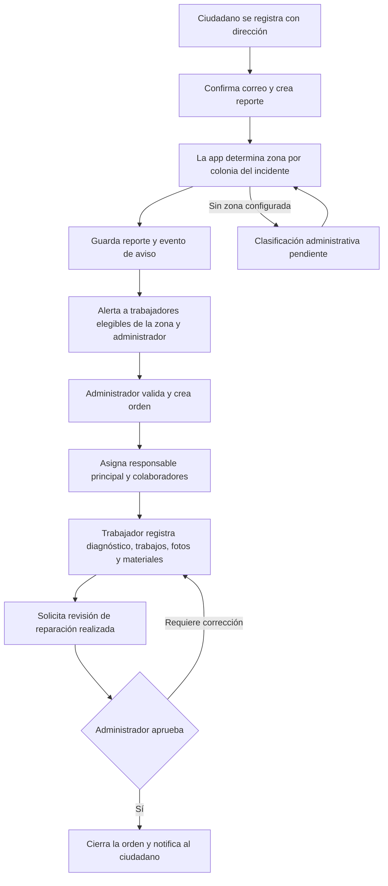

# ODAPAS Report — Resumen del funcionamiento

La documentación completa está en [ODAPAS_REPORT_ESPECIFICACION.md](ODAPAS_REPORT_ESPECIFICACION.md). Esta versión define el funcionamiento para construir después la DB normalizada.

## Alternativa elegida

**Ciudadano:** registro público con nombre, correo, contraseña, teléfono y dirección. Reporta en su domicilio o en otra ubicación de cobertura; consulta folio, avance y avisos.

**Trabajador ODAPAS:** lo da de alta el administrador con identidad laboral, número de empleado, especialidad y una zona específica. Activa su cuenta con invitación y recibe avisos de su zona. No puede autorregistrarse como trabajador.

**Administrador:** configura zonas y personal, revisa reportes, asigna responsables y verifica el cierre de los trabajos.

## Recorrido principal

## Reglas esenciales

- El reporte utiliza la ubicación del incidente; cambiar domicilio del ciudadano no modifica reportes anteriores.
- Una zona contiene varias colonias; cada colonia tiene una zona activa en la versión inicial.
- Un trabajador tiene una zona principal vigente; los cambios conservan historial.
- Una alerta territorial informa; la responsabilidad surge de una asignación administrativa.
- Un incidente principal admite una orden activa; varias personas pueden trabajar en ella con un responsable principal.
- Verificación del reporte, reparación técnica y cierre administrativo son hechos distintos.
- Un trabajador atiende sus asignaciones; no modifica trabajos ajenos por conocer su folio.
- No se pierde el caso si no hay personal disponible o falla un aviso: queda pendiente y se alerta al administrador.
- La bandeja de avisos es persistente; los avisos externos dependen del canal/dispositivo habilitado.

## Próximo paso

Rehacer el modelo relacional con cuentas/perfiles, direcciones, zonas/cobertura, adscripciones, invitaciones, reportes, órdenes, asignaciones, reparaciones, materiales y notificaciones, manteniendo 1FN, 2FN y 3FN.

El SQL/DBML anterior de 32 tablas aún no incluye todas estas nuevas reglas y entidades. Los nuevos registros, permisos y alertas son especificaciones pendientes de implementación.
